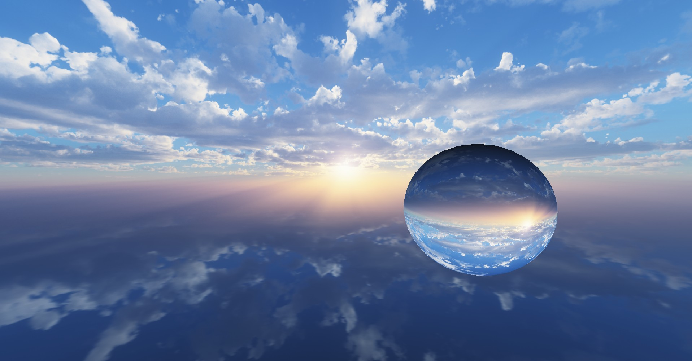
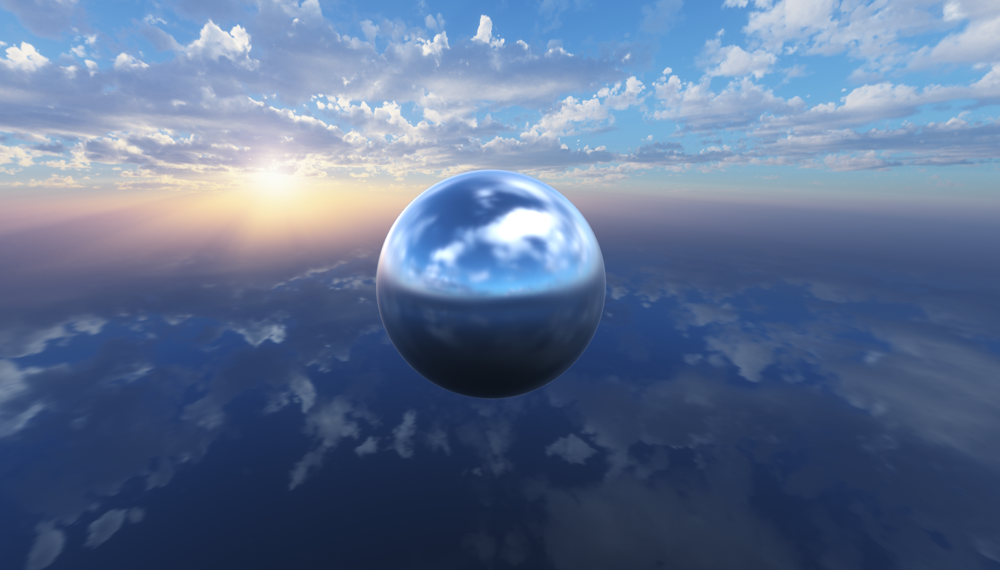
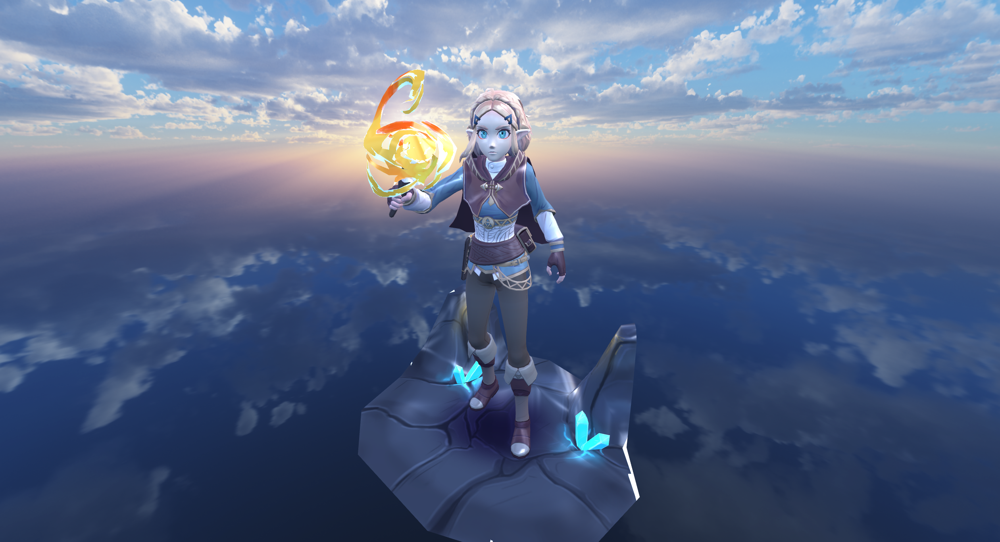
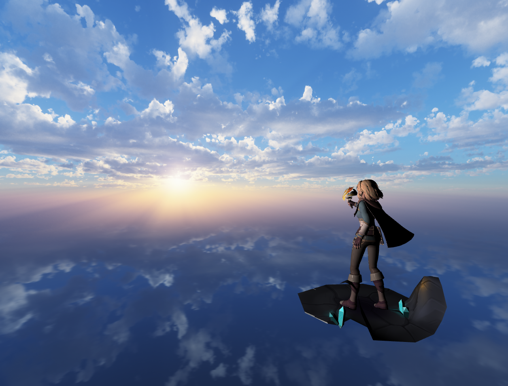
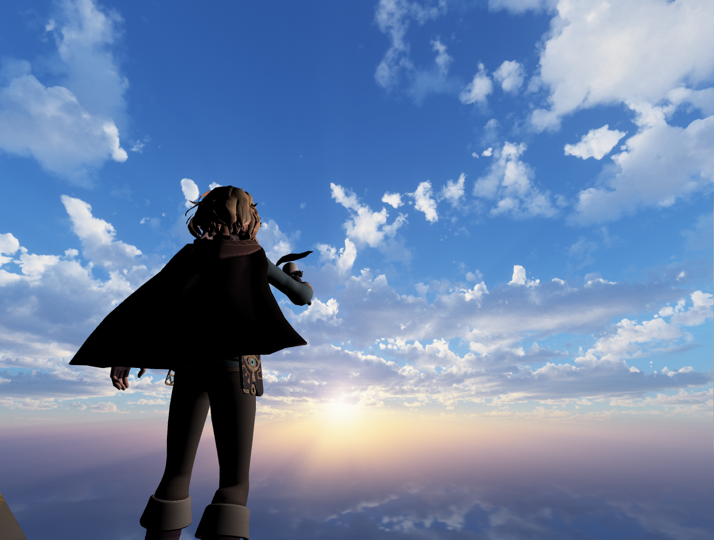
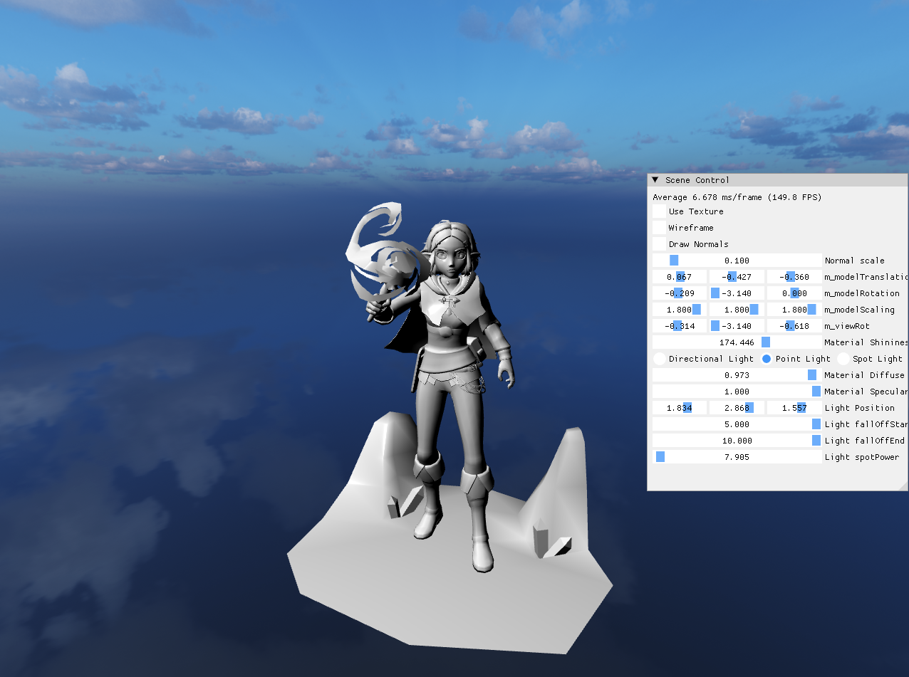
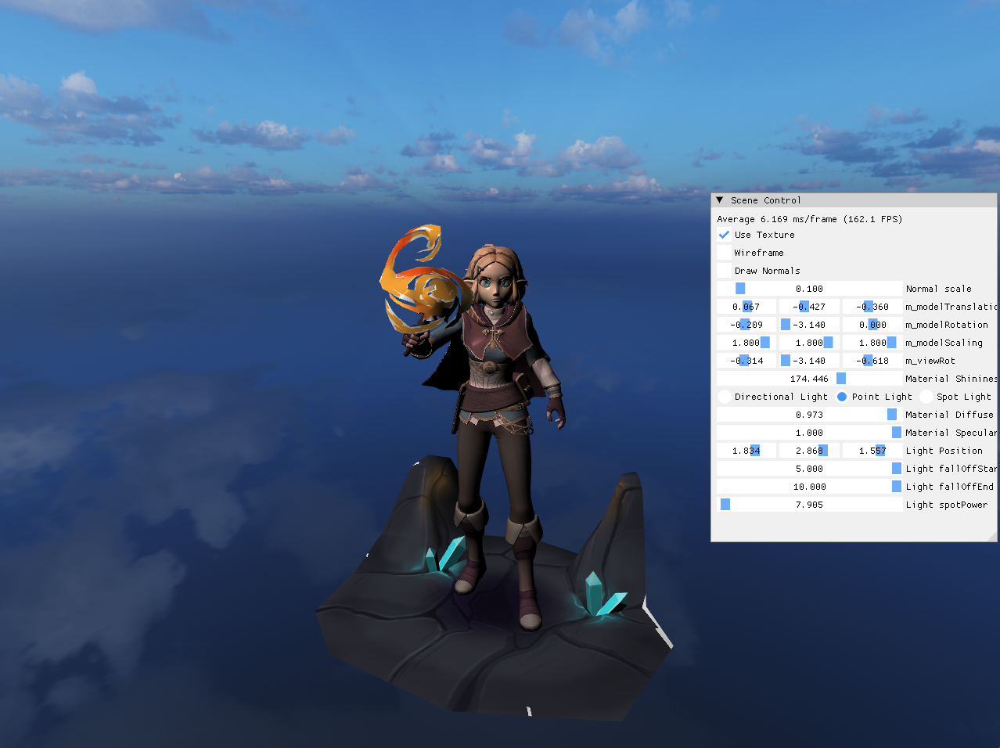
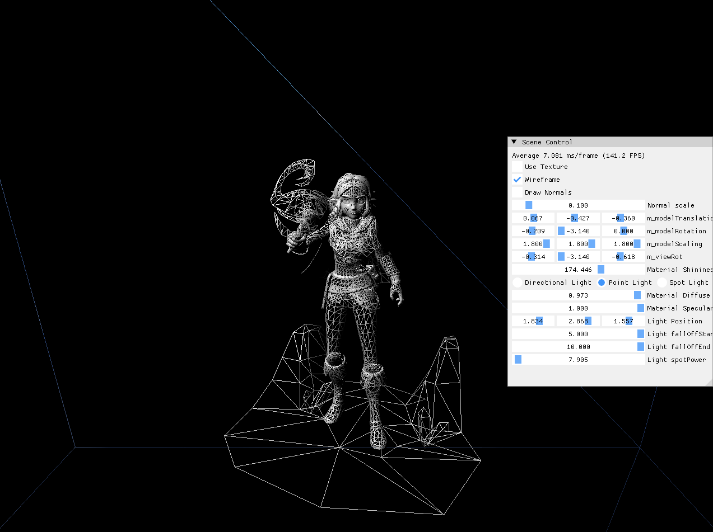
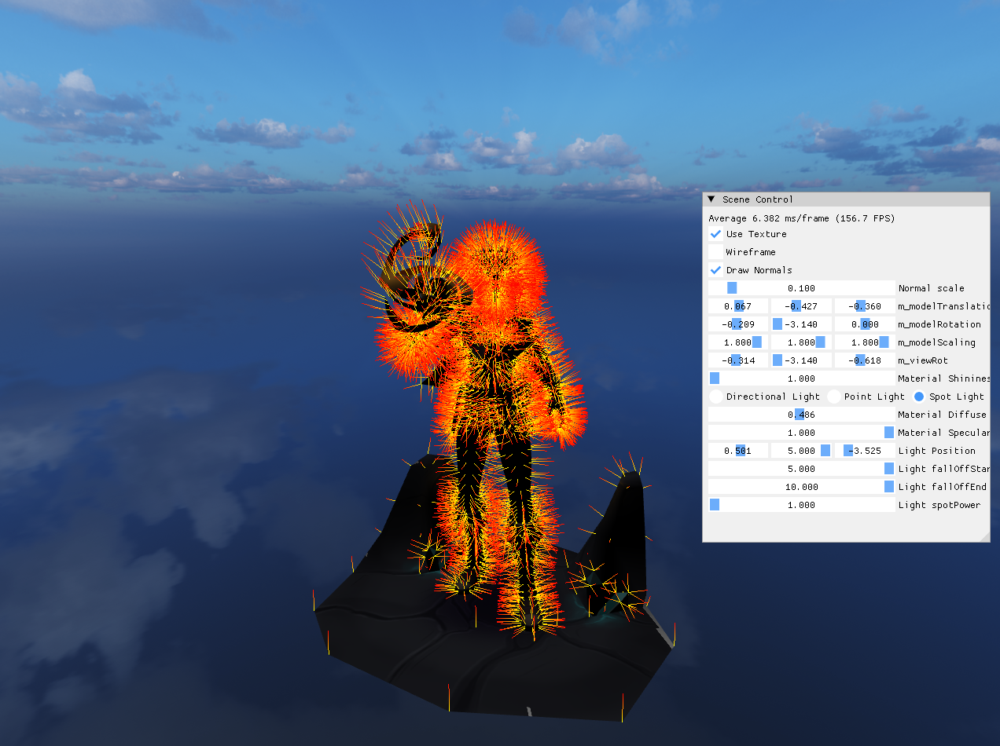

# ComputerGraphicsWithDirectX11_Public

컴퓨터 그래픽스 학습 후, 제작한 프로젝트 및 결과물입니다. 

학습 과정에 따라 결과물을 주기적으로 업로드 예정입니다. 

홍정모 연구소의 컴퓨터 그래픽스 강의를 기반으로 학습 후 제작하였습니다. 

F3D 모델을 활용하였습니다. 

## 결과 이미지

### 구현 결과 이미지
#### 레이트레이싱 기반 렌더링

#### 래스터라이제이션 기반 렌더링
- 이미지 기반 라이팅 적용

 
- 큐브 매핑, 3D 모델 사용

 
- 활용 3D 모델 구조

### 학습 내용
- Ray Tracing 
- 3차원 구 
- 조명 효과 
- 원근 투영 
- 삼각형 그리기 및 최적화 
- 그림자 
- 텍스처링 
- 수퍼 샘플링 
- 빛의 반사 
- 투명한 물체와 빛의 굴절 
- 큐브 매핑 
- 래스터라이제이션 
- 아핀 변환 
- 3차원 모델링 
- 환경 매핑 
- 이미지 기반 라이팅 